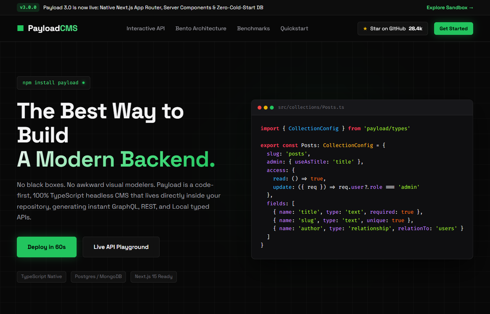

# Payload CMS (Toxa) — Dasturchilar Uchun Yangi Avlod Headless TypeScript CMS

Payload CMS — to'liq kodga asoslangan, 100% TypeScript va Next.js ekotizimiga moslashtirilgan, avtomatik GraphQL va REST API generatsiyasiga ega ochiq manbali Headless CMS platformasining developer-first veb-interfeysi (UI).

---

## 📸 Veb-Sahifa Ko'rinishi (Skrinshot)

---

## 🌟 Asosiy Imkoniyatlar va Funksiyalar

1. **Dasturchilar Uchun Dark Mode Uslubi**:
   - Monoxrom chuqur qora (`#080808`), terminal maydoni va elektr yashil aksent (`#22c55e`).
   - `Fira Code` dasturlash shrifti va sintaksis ranglari bilan boyitilgan kod bloklari.

2. **Interaktiv API Maydonchasi (Interactive Code Playground)**:
   - Local API (Next.js Server Component ichidagi eng tezkor so'rov), Avtomatik REST API (HTTP cURL) va Tipizatsiyalangan GraphQL so'rovlari o'rtasida tablar orqali almashish va jonli JSON natijasini ko'rish.
   - Bir klikda kodni clipboardga nusxalash tugmasi.

3. **Tezlik va Latency Taqqoslash Reytingi (Benchmarks)**:
   - Payload Local API (1.2 ms, nol HTTP xarajati), Strapi (48 ms) va Contentful (115 ms) o'rtasidagi sovuq ishga tushish tezligi vizualizatsiyasi.

4. **Arxitektura Super-Qobiliyatlari Bento Gridi**:
   - To'liq erkin React boshqaruv paneli, PostgreSQL / SQLite / MongoDB adapterlari, maydon darajasidagi RBAC xavfsizligi va o'rnatilgan ko'p tillilik.

5. **Tezkor CLI Ishga Tushirish Vidjeti**:
   - `npx create-payload-app@latest` buyrug'ini bir bosishda nusxalash va GitHub yulduzlar simulyatsiyasi (`★ 28.4k`).

---

## 🛠 Texnologiyalar Steki

- **HTML5**: Dasturchilar uchun maxsus ishlab chiqilgan kod blokli semantika.
- **CSS3 (Vanilla)**: Matrix grid foni, terminal darchalari, yashil neon nur effektlari.
- **JavaScript (ES6+)**: API tablari almashinuvi, nusxalash bildirishnomalari, GitHub yulduz sanagichi.
- **Shriftlar**: Google Fonts (Space Grotesk, Fira Code).

---

## 🔗 Havolalar

- **GitHub Repositoriyasi**: [https://github.com/qodirovtoirbektts-jpg/toxa-payloadcms](https://github.com/qodirovtoirbektts-jpg/toxa-payloadcms)
- **Jonli Veb-Sahifa (Live Demo)**: [https://qodirovtoirbektts-jpg.github.io/toxa-payloadcms/](https://qodirovtoirbektts-jpg.github.io/toxa-payloadcms/)

---

### 👨‍💻 Muallif
**Toxa (qodirovtoirbektts-jpg)**
